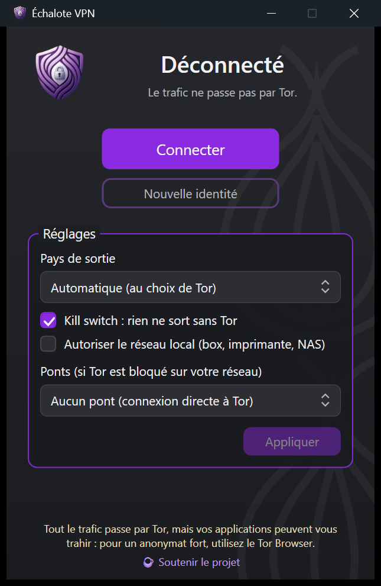

<p align="center">
  
</p>

<h1 align="center">Échalote VPN</h1>

<p align="center">
  <strong>Faites passer tout le trafic de votre PC Windows par le réseau Tor, en un clic.</strong><br>
  Gratuit, libre, sans publicité ni abonnement.
</p>

<p align="center">
  <a href="https://github.com/yvesdejoux-cell/echalote-vpn/releases/latest"></a>
  <a href="LICENSE"></a>
  
  <a href="https://ko-fi.com/ptidej"></a>
</p>

<p align="center">
  <a href="https://github.com/yvesdejoux-cell/echalote-vpn/releases/latest"><strong>⬇ Télécharger Échalote VPN pour Windows</strong></a>
</p>

<p align="center">
  
</p>

## Ce que fait Échalote VPN

- **Tout passe par Tor** : navigateurs, applications, mises à jour… comme avec un VPN, mais
  à travers le réseau Tor. Les sites voient l'adresse d'un relais Tor, pas la vôtre, et votre
  fournisseur d'accès ne voit pas quels sites vous visitez.
- **Kill switch** : si Tor se coupe, plus rien ne sort de votre PC, même en cas de plantage. Pas de
  fuite d'adresse IP, de DNS, d'IPv6 ni de WebRTC.
- **Choix du pays de sortie** et **nouvelle identité** (nouvelle adresse) en un clic.
- **Ponts obfs4** pour se connecter quand Tor est bloqué sur votre réseau (pays censurés,
  réseaux d'entreprise ou d'école).
- **Discret** : une icône près de l'horloge, qui démarre avec Windows si vous le souhaitez.

## Installer

1. Téléchargez `EchaloteVpn-Setup-x.y.z.exe` sur la
   [page des versions](https://github.com/yvesdejoux-cell/echalote-vpn/releases/latest).
2. Lancez-le. **Windows SmartScreen peut afficher un avertissement**, car l'installateur n'est pas
   encore signé : cliquez sur **Informations complémentaires**, puis **Exécuter quand même**.
3. Acceptez la demande de droits administrateur, puis suivez l'assistant.

Windows 10 ou 11, 64 bits. Rien d'autre à installer : Tor est inclus. Si vous aviez installé
TorVpn ou OnionGuard (anciens noms d'Échalote VPN), l'installateur les remplace.

## Utiliser

1. Ouvrez Échalote VPN (icône près de l'horloge, ou menu Démarrer).
2. Cliquez sur **Connecter**. Après quelques secondes, la fenêtre affiche **Connecté via Tor** et
   le pays de sortie.
3. Pour vérifier : ouvrez https://check.torproject.org dans votre navigateur.
4. **Déconnecter** rend la connexion normale.

Fermer la fenêtre ne coupe pas la connexion : Échalote VPN reste près de l'horloge (clic droit
sur l'icône pour le menu). Seul **Déconnecter** coupe le passage par Tor.

**Réglages** : pays de sortie, kill switch, accès au réseau local (box, imprimante, NAS) et ponts.
Si la connexion n'aboutit pas, choisissez **Ponts obfs4 intégrés**, ou collez vos propres ponts
obtenus sur https://bridges.torproject.org.

> Désactivez tout autre VPN avant de vous connecter (Mullvad : désactivez aussi le
> « lockdown mode »).

## Limites, à lire

- **Moins anonyme que le Tor Browser.** Vos navigateurs et applications habituels laissent des
  traces qui permettent de vous reconnaître (comptes connectés, cookies, empreinte du navigateur).
  Pour un anonymat fort, utilisez le [Tor Browser](https://www.torproject.org/download/).
- **Plus lent** qu'une connexion normale : le trafic traverse trois relais dans le monde.
- **Pas d'UDP** : les appels vidéo et la VoIP, les jeux en ligne ou le BitTorrent ne passent pas.
- Les sites en `.onion` ne s'ouvrent que dans le Tor Browser.
- Certains sites bloquent ou soumettent à des captchas les connexions venant de Tor.

## En cas de problème

**Plus d'Internet après un plantage ?** Le kill switch protège même après un redémarrage. Ouvrez
PowerShell **en administrateur** et tapez :

```powershell
& "C:\Program Files\EchaloteVpn\service\EchaloteVpn.Service.exe" --reset-network
```

**Un bug, une question ?** Ouvrez une
[issue](https://github.com/yvesdejoux-cell/echalote-vpn/issues).

## Soutenir le projet

Échalote VPN est gratuit et le restera. Si l'application vous rend service, un don ponctuel sur
[Ko-fi](https://ko-fi.com/ptidej) aide à la faire vivre.

## In English

**Échalote VPN** routes all Windows traffic through the Tor network, like a VPN: kill switch
(no IP, DNS, IPv6 or WebRTC leaks), exit-country choice, new identity and obfs4 bridges.
Free and open source (GPL-3.0), Windows 10/11 64-bit.
[Download the installer](https://github.com/yvesdejoux-cell/echalote-vpn/releases/latest)
(SmartScreen may warn: *More info* → *Run anyway*). It is weaker than Tor Browser for anonymity;
use Tor Browser when anonymity matters.

## Pour les développeurs

Architecture, compilation et fonctionnement interne :
[docs/DEVELOPPEMENT.md](docs/DEVELOPPEMENT.md).

## Licence

GPL-3.0-or-later, voir [LICENSE](LICENSE). Échalote VPN n'est ni développé ni soutenu par le Tor
Project ; il utilise le logiciel Tor. « Tor » est une marque du Tor Project, Inc.
